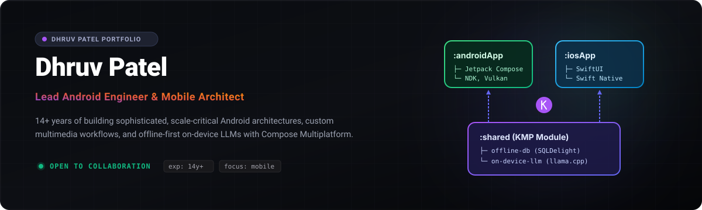

  

  <strong><a href="https://deardhruv.github.io">Live Portfolio</a></strong> · 
  <strong><a href="https://deardhruv.com">Technical Blog</a></strong> · 
  <strong><a href="https://www.linkedin.com/in/deardhruv/">LinkedIn</a></strong> ·
  <strong><a href="mailto:dhruv.time@gmail.com">Email</a></strong>

***

  

Here are selected systems and applications showcasing full-lifecycle mobile engineering:

### 🧠 [Model Playground](https://github.com/DearDhruv/Model-Playground)
* **Role:** Lead Architect & Solo Developer
* **Tech:** Kotlin Multiplatform, llama.cpp (C++ via JNI/NDK), MediaPipe, Compose UI
* **Impact:** An offline-first, on-device LLM playground for Android. Runs open-source models completely locally (using Vulkan acceleration) with zero data leaving the user device. Features a curated catalog, range-resumable download client, and local GGUF/Task model importing.

### 💡 [VelociHue](https://play.google.com/store/apps/details?id=com.deardhruv.velocihue)
* **Role:** Creator & Solo Developer
* **Tech:** Kotlin, Jetpack Compose, Philips Hue local APIs, KMP
* **Impact:** Shipped a responsive mobile client for Philips Hue lights optimized for low-latency network communication and game-like UI response loops. Published on the Google Play Store.

### 🛒 Digital Commerce Platform
* **Role:** Lead Android Engineer
* **Tech:** Kotlin, Jetpack Compose, MVVM Architecture, Flow
* **Impact:** Architected scalable mobile layers processing millions of transactions for international markets. Implemented responsive adaptive layouts for foldable screen formats, improving core app performance and lowering load times by 40%.

### 🔌 Hardware POS Integration Module
* **Role:** Core Architect
* **Tech:** Android NDK, JNI, C++, BLE, USB Host APIs
* **Impact:** Created a unified interface library linking Android applications to physical Point-of-Sale (POS) systems and 15+ peripherals. Achieved 99.8% communication stability and reduced transmission latency by 60%.

### 🎬 Multimedia Editing Engine
* **Role:** Tech Lead
* **Tech:** OpenGL ES, MediaCodec API, Kotlin, Custom Shaders
* **Impact:** Developed high-throughput frame processing pipelines and video compilation libraries supporting 60fps real-time effect preview rendering on mid-tier hardware.

***

  

* **Lead Android Engineer** @ *Impact Commerce* (2022 — Present)
  * Architecting next-generation digital commerce solutions for large enterprise clients.
  * Spearheading migration of legacy codebases to 100% Kotlin + Declarative Compose UI.
  * Mentoring and scaling teams of 5+ mobile developers.
* **Senior Android Architect & Consultant** @ *Various Enterprise Partners* (2012 — 2022)
  * Designed modular architectures (MVI/MVVM), Bluetooth POS drivers, and local DB engines.
  * Implemented automated testing frameworks that cut production bugs by 45%.
* **Early Android Developer** @ *Mobile Software Startups* (2012 & Earlier)
  * Shipped mobile apps since the early days of the Android SDK (Gingerbread/Honeycomb).

***

  

| Category | Technologies |
| :--- | :--- |
| **Languages** | Kotlin, Java, C/C++ (JNI/NDK), SQL, Bash |
| **Mobile Systems** | Android SDK, Jetpack Compose, Compose Multiplatform, KMP, SwiftUI |
| **Specialized Engineering** | On-Device LLM (llama.cpp/MediaPipe), OpenGL ES, MediaCodec, Vulkan SDK, POS Hardware APIs |
| **Architectures** | MVI, MVVM, Clean Architecture, SOLID Principles, Git Submodules, Dagger Hilt |

***

  Dhruv Patel — Lead Android Engineer &amp; Mobile Architect • CC BY-NC 4.0

